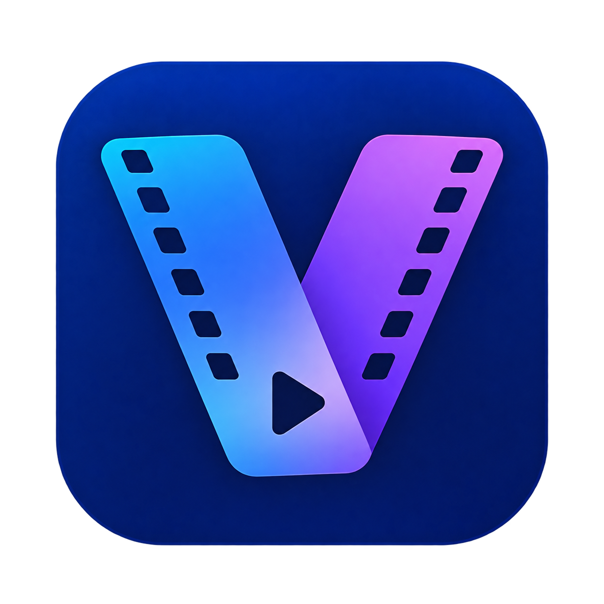
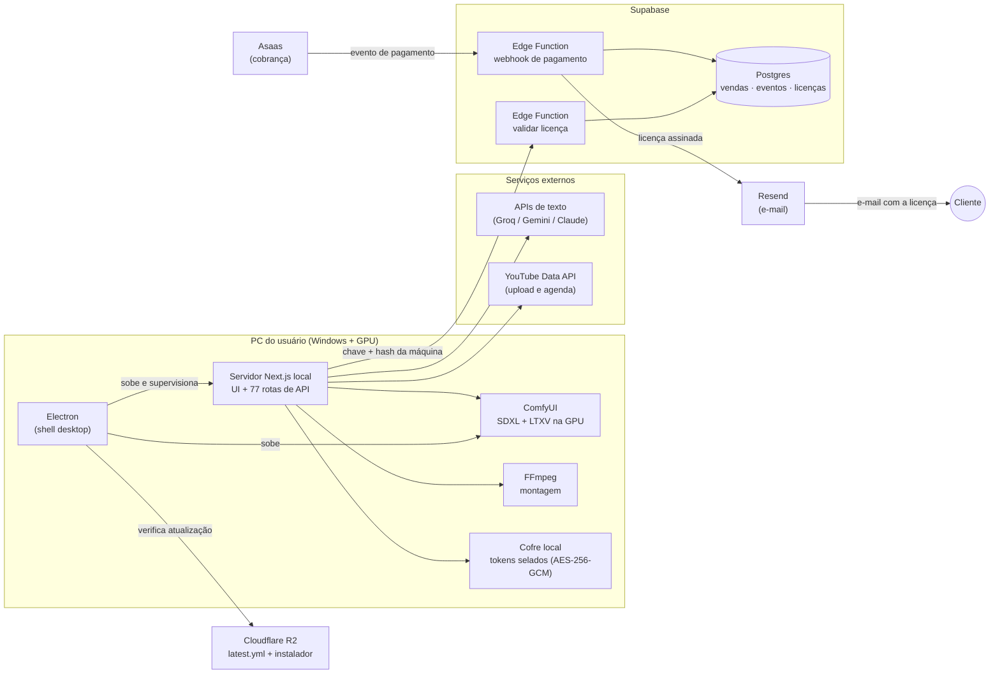

# Vicutra

**Seu canal merece uma central de produção.**
Do assunto ao vídeo pronto — roteiro, imagens, narração, legenda e publicação — com a IA rodando na **sua própria placa de vídeo**.

[Site oficial](https://clippilot.onkz.com.br) · Suporte: contato@onkz.com.br

> **Este repositório é uma apresentação (case study).** O código-fonte do Vicutra é proprietário e **não** está aqui. O que está aqui é a descrição do produto, da arquitetura e das decisões de engenharia, com os números medidos no código.

---

## O problema

Quem produz vídeo curto para YouTube (Shorts) e redes sociais repete o mesmo trabalho todo dia: achar um assunto em alta, escrever o roteiro, conseguir imagens, gravar a narração, legendar, montar, publicar. As ferramentas de IA que fazem isso costumam cobrar por vídeo e rodar na nuvem de outra empresa.

O **Vicutra** é um aplicativo de desktop para Windows (antes chamado *ClipPilot*) que junta essa linha de produção num lugar só e roda a parte pesada — geração de imagem e animação — **localmente, na GPU do próprio usuário**.

## O que o produto faz (confirmado no código)

| Etapa | Como é feito |
|---|---|
| **Tendências** | Coleta de assuntos em alta (Google Trends e YouTube) por nicho, com cache e pontuação. |
| **Roteiro** | Motor de texto agnóstico de provedor com cadeia de *fallback* (Groq → Gemini → Claude → opção gratuita) e, se tudo falhar, um gerador por regras. Inclui checagem de fatos e geração de hashtags. |
| **Imagem** | **ComfyUI local** (SDXL) na placa do usuário, com provedores em nuvem como alternativa. |
| **Vídeo por cena** | Imagem SDXL animada com **LTXV via ComfyUI, na GPU local**; integração opcional com APIs de vídeo de terceiros (catálogo marcado como "em integração"). |
| **Voz** | Narração neural em PT-BR via edge-tts, com tempo de cada palavra para legenda sincronizada; ElevenLabs opcional. |
| **Montagem** | FFmpeg (empacotado no instalador) junta cenas, narração, legenda e música. |
| **Estúdio de clipes** | Corta vídeos longos em clipes curtos: transcrição (Whisper no navegador ou Groq), detecção heurística de "melhores momentos", legendas e capa. |
| **Publicação** | Envio e agendamento no YouTube (OAuth); integração com Páginas do Facebook e conexão com TikTok (ver *Status*). |
| **Licenciamento** | Licença assinada, vinculada a uma máquina, entregue automaticamente após o pagamento. |

## Stack (medida no `package.json` e no código)

| Camada | Tecnologia | Evidência |
|---|---|---|
| Interface + API local | **Next.js 15**, **React 19**, **TypeScript 5**, Tailwind CSS 4 | `dependencies`/`devDependencies`; 77 rotas de API em `src/app/api` |
| Aplicativo desktop | **Electron 42** + **electron-builder** (instalador NSIS) | `main: electron/main.js`; o Electron sobe o servidor Next *standalone* e o ComfyUI como processos filhos |
| IA local | **ComfyUI** (SDXL + LTXV) na GPU do usuário | `electron/main.js` (inicialização do ComfyUI), `src/core/generate/video-providers.ts` |
| Vídeo | **FFmpeg / FFprobe** empacotados; `@ffmpeg/ffmpeg` (WASM) no estúdio | `build.extraResources` → `vendor/` |
| Voz e transcrição | `msedge-tts`, `@huggingface/transformers` (Whisper no navegador) | `src/core/generate/tts.ts`, `src/core/clips/transcribe/` |
| Texto | Groq / Gemini / `@anthropic-ai/sdk` com fallback | `src/core/generate/llm.ts` |
| Tendências | `google-trends-api`, YouTube Data API | `src/core/providers/` |
| Backend | **Supabase**: Postgres (11 migrações) + **Edge Functions em Deno** | `supabase/functions/`: webhook de pagamento, validação de licença e funções administrativas |
| Pagamento | **Asaas** (webhook) | `supabase/functions/asaas-webhook` |
| E-mail transacional | Resend (entrega da licença) | `supabase/functions/_shared/mailer.ts` |
| Atualização automática | **electron-updater** com manifesto `latest.yml` servido de armazenamento de objetos (Cloudflare R2) | `electron/main.js` (`setFeedURL` genérico) |
| Distribuição | Site estático + instalador em Cloudflare | `scripts/publicar-*.mjs` |

## Arquitetura

**Fluxo de uma venda:** o cliente paga no Asaas → o Asaas chama o webhook (Edge Function) → o evento é registrado de forma idempotente → a licença é assinada no servidor e enviada por e-mail → o aplicativo valida a licença contra a Edge Function, que confere assinatura, validade, revogação e máquina.

## Destaques de engenharia e segurança

Todos os itens abaixo foram conferidos no código ou em documento de auditoria com data.

- **Webhook idempotente pelo banco, não pela memória.** Cada evento do Asaas é registrado com o seu id como chave primária; uma entrega repetida cai em violação de unicidade (`23505`) e é tratada como sucesso. Duas entregas simultâneas do mesmo evento não processam a venda duas vezes.
- **Autenticação do webhook em tempo constante.** O token enviado pelo Asaas é comparado sem atalho, para não vazar informação pelo tempo de resposta.
- **Lista fechada de eventos.** Só eventos de cobrança são tratados; eventos de saque, transferência ou conta bancária são **recusados** — o backend registra cobrança, nunca movimenta dinheiro.
- **Segredos só nas Edge Functions.** Chave privada de assinatura, token do Asaas e chave do provedor de e-mail vivem apenas no servidor. Uma varredura de 06/09/2026 procurou valores reais de segredo em 465 arquivos construídos do cliente: **0 encontrados**.
- **RPC fechada para `anon`.** Uma auditoria interna achou (P0) que as funções `SECURITY DEFINER` do backend de vendas podiam ser chamadas com a chave pública; a correção (`revoke execute … from anon, authenticated`) entrou numa migração própria, aplicada **na ordem certa** (primeiro trocar a chave usada pela função, depois revogar), para não derrubar as vendas.
- **Licença assinada com Ed25519**, uma máquina por licença, guardando só *hash* da chave e da máquina; estorno e *chargeback* **revogam a licença automaticamente** (migração dedicada).
- **`state` do OAuth assinado com HMAC-SHA256** e verificado com `timingSafeEqual` (integração com o Facebook).
- **Tokens de canal selados em disco com AES-256-GCM**; a chave fica protegida pelo `safeStorage` do Electron, nunca em texto.
- **Auditoria do artefato antes de empacotar.** Um script bloqueia o build se encontrar dado pessoal ou segredo dentro do instalador — criado depois de um incidente real em que dados de teste do autor entraram no pacote.
- **Atualização com download diferencial** (`.blockmap`) e instalação só ao fechar o app, nunca no meio de uma renderização.
- **Dependências:** `npm audit --omit=dev` com **0 vulnerabilidades** (registro de 06/09/2026); *overrides* para forçar versões corrigidas de dependências transitivas.
- **Portões de qualidade da mesma auditoria:** `tsc` com 0 erros, **864/864 testes** passando, 0 `eval`/`new Function`, 0 `: any` explícito, 0 `catch {}` vazio, 0 CORS aberto.

## Números (medidos em 15/10/2026, versão 0.2.117)

| Métrica | Valor |
|---|---|
| Arquivos TypeScript em `src/` | 386 (289 `.ts` + 97 `.tsx`) |
| Linhas de TypeScript em `src/` | ~57 mil |
| Rotas de API | 77 |
| Telas (`page.tsx`) | 16 |
| Edge Functions (Deno) | 4 |
| Migrações SQL | 11 |
| Arquivos de teste | 91 (unitários, contrato, integração e vendas) |
| Casos de teste | ~850 (contagem estática); última execução registrada: **864/864** em 06/09/2026 |

## Status (honesto)

- O produto está em **fase de lançamento comercial**: backend de vendas em produção, entrega automática de licença, site no ar e atualizador funcionando.
- **Não há números de vendas ou de usuários publicados aqui** — não vou inventá-los.
- Limitações conhecidas e documentadas: a publicação no TikTok existe hoje só como conexão de conta (sem envio de vídeo); a integração com Páginas do Facebook depende de aprovação da Meta para funcionar para clientes; parte do estúdio de clipes ainda baixa bibliotecas de CDN e precisa de internet.

## Como foi construído

O Vicutra foi desenvolvido com **IA como par de programação** (Claude e Codex). O papel do autor foi a **direção de produto**: definir o que construir e para quem, escrever as especificações, revisar o que a IA produzia, decidir entre alternativas, desenhar e rodar os testes (inclusive testes de sabotagem, que quebram o código de propósito para provar que o teste pega), operar o backend, os deploys e as auditorias.

Na prática, isso exigiu as habilidades que mais uso em suporte e qualidade: **reproduzir o problema antes de corrigir, medir em vez de supor, documentar cada decisão com data e evidência** e desconfiar do próprio instrumento de medida — a auditoria de 06/09/2026, por exemplo, registra quatro falsos positivos do próprio auditor, conferidos e descartados antes de virar achado.

## Aviso

O código-fonte do Vicutra é **proprietário**. Este repositório contém apenas material de apresentação (texto e identidade visual) e não concede nenhuma licença de uso do software.

**Site oficial:** https://clippilot.onkz.com.br
